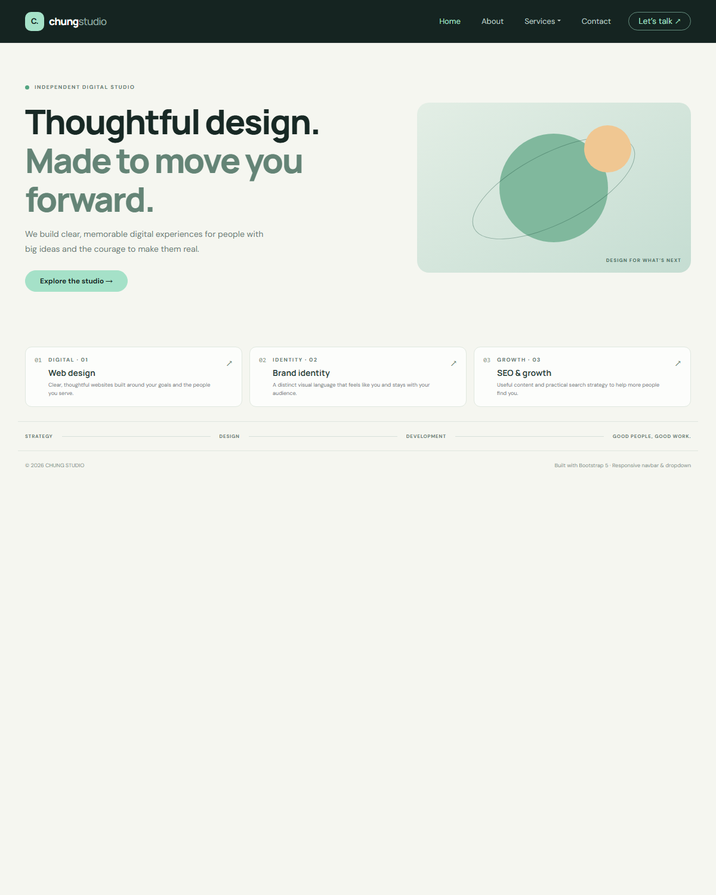

# Responsive Bootstrap Navbar

Bootstrap 5.3 Navbar with a responsive collapse toggle, active links, a Services dropdown, and a compact studio hero.

## Run

Open `index.html` while connected to the internet so the Bootstrap and Google Fonts CDNs can load. On a narrow screen, use the menu button to open the navigation and select Services to open its dropdown.

## Screenshots

### Desktop

### Mobile

